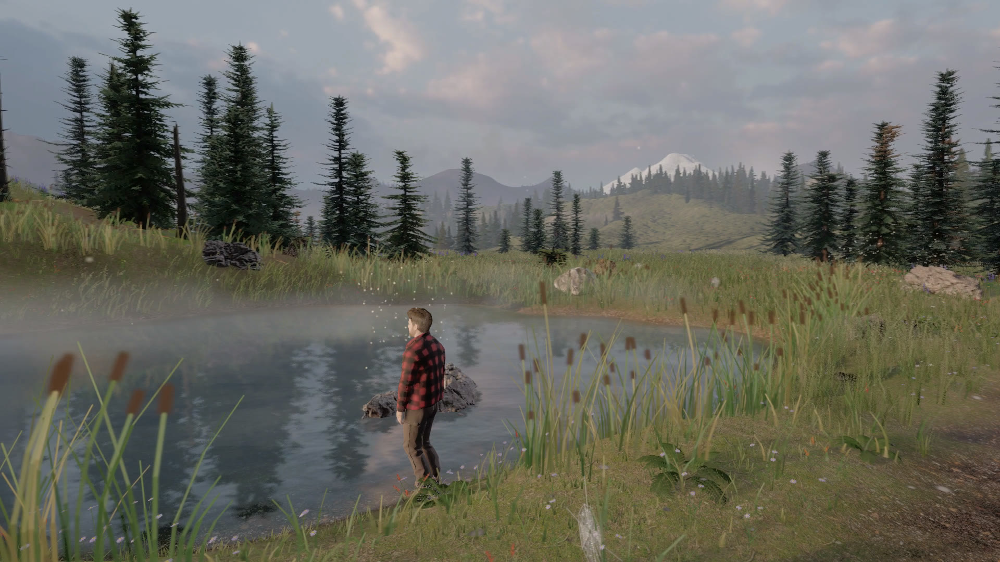

# Spaghetti splats for Bevy



Render Gaussian-convolved line segments in a Bevy 0.20 3D scene. Splats draw grass, needles, hair, smoke, and scanned props next to ordinary Bevy meshes. The crate includes a Rust glTF converter, an orbit viewer, and Windward, a playable wetland demo.

## Quick start

Walk through Windward, the scene above:

```sh
cargo run --release --example windward
```

Orbit a marble bust made of 240,000 splats:

```sh
cargo run --example viewer
```

In the viewer, drag to orbit, right-drag to pan, and scroll to zoom. Press **Space** for the turntable or **R** to reset.

## Documentation

- [Add splats to a game](docs/usage.md): set up the plugin, build assets, and use the wind, lighting, and flow components.
- [Convert a model](docs/converter.md): turn glTF or GLB files into `.spag` assets.
- [Windward](docs/windward.md): controls, credits, and recording a 1080p60 clip.
- [Rendering scope](docs/rendering.md): what the renderer implements from the paper, its limits, and the tests.
- [The .spag file format](docs/format.md): the byte layout of versions 1 and 2.

The renderer implements the Gaussian inference method in [Spaghetti Splatting, sections 3.2–3.5](https://arxiv.org/html/2611.12716v1#S3).
